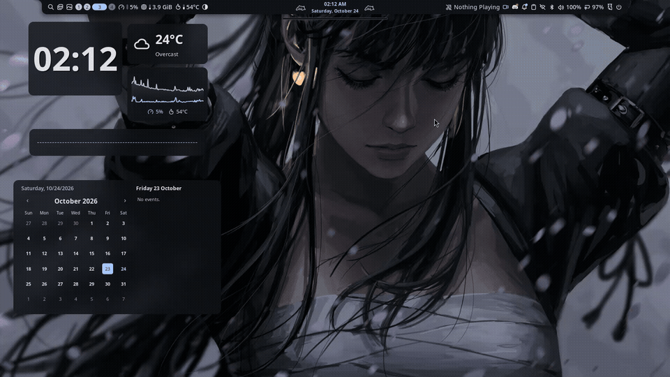

<div align="center">

# ⛩️ CachyOS + Niri + Noctalia Rice
### *Atmospheric Dark Fantasy Desktop featuring 3D Spatial Parallax & Responsive Terminal Stickers*


</div>

---

## 🎬 Showcase

<!-- 
TIP: Drop your showcase video or GIF here!
You can record your screen with `gpu-screen-recorder` or Noctalia's top-bar screen recorder,
then drag and drop the .mp4 or .gif directly into the GitHub repository issue/release/assets!
-->

<div align="center">
  
  <p><i>3D Spatial Mouse Parallax Wallpaper in action alongside responsive Fastfetch stickers & Noctalia widgets.</i></p>
</div>

---

## ✨ Features & Highlights

### 🌌 1. 3D Spatial Mouse Parallax Wallpaper
* **Engine:** Powered by [`shiftpaper`](https://github.com/CPritch/shiftpaper) with **MoGe-2** metric depth estimation.
* **Smooth Camera Projection:** Tuned `parallax_intensity = 0.004` in `config.toml` for realistic, responsive 3D perspective camera tilting without blurry edge-stretching artifacts.
* **Low Overhead:** Lightweight OpenGL/Vulkan rendering on Wayland `wlr-layer-shell`.

### 🐱 2. Dynamic Responsive Fastfetch Stickers
* **Width-Aware Fish Wrapper:** Built-in terminal width detection (`tput cols`) in `~/.config/fish/config.fish`.
  * **Half-Screen / Tiled (< 90 cols):** Automatically renders a compact, clean ASCII CachyOS logo.
  * **Full-Screen / Wide (≥ 90 cols):** Automatically renders high-resolution transparent GUWEIZ character stickers with Kitty icat graphics protocol.
* **Intelligent Dual-GPU Labeling:** Differentiates Intel Integrated GPU as **`iGPU`** and dedicated GTX graphics as **`GPU`**.

### 🎨 3. Noctalia Desktop Shell & Widget Dashboard
* **Balanced Composition:** Desktop widgets are thoughtfully arranged on the open left side, keeping the character on the right completely unblocked:
  * **Top-Left:** Minimalist digital Clock & Date header.
  * **Top-Center-Left:** Compact Weather card.
  * **Mid-Left:** System CPU gauge & responsive horizontal Audio Spectrum Visualizer.
  * **Bottom-Left:** Calendar block.
  * **Center:** Fancy circular glowing bloom visualizer floating into the mist.
* **Unified Theme Sync:** Noctalia dynamically extracts color palettes from the active wallpaper and synchronizes them across:
  * **Niri** active border glows (`#a2c9fe`)
  * **Kitty Terminal** color palette
  * **KDE Dolphin** file manager (`Noctalia.colors`)
  * **GTK 3 / 4** applications
  * **Btop** resource monitor
  * **Yazi** terminal file manager

### 🌐 4. Zero-Crop Chrome New Tab Background
* Mathematical zero-crop technique: Formatted 16:10 artwork (`wallhaven-gp51xq`) to fit standard 16:9 viewports (1600×900) using ambient Gaussian-blurred edge expansion, preventing Chrome from cutting off character heads or phones.

---

## 🛠️ Software Stack

| Component | Software |
| :--- | :--- |
| **Operating System** | [CachyOS Linux](https://cachyos.org/) (Kernel 7.3+ / Arch based) |
| **Compositor** | [Niri](https://github.com/YaLTeR/niri) (Scrollable tiling Wayland compositor) |
| **Desktop Shell** | [Noctalia](https://github.com/noctalia-dev/noctalia) (Quickshell-based desktop shell) |
| **Wallpaper Parallax** | [Shiftpaper](https://github.com/CPritch/shiftpaper) (`shiftpaperd`) |
| **Terminal** | [Kitty](https://sw.kovidgoyal.net/kitty/) |
| **Shell** | [Fish Shell](https://fishshell.com/) |
| **System Fetch** | [Fastfetch](https://github.com/fastfetch-cli/fastfetch) |
| **File Managers** | Dolphin (GUI) / Yazi (TUI) |
| **System Monitor** | Btop |
| **Typography** | JetBrains Mono Nerd Font |
| **Cursor Theme** | Bibata Modern Classic (24px) |

---

## 📥 Installation

```bash
# 1. Clone your dotfiles repository
git clone https://github.com/LawrenceTanny/dotfiles.git ~/dotfiles
cd ~/dotfiles

# 2. Run the installer script
chmod +x install.sh
./install.sh
```

---

## 📹 How to Record Your Showcase Video

You have `gpu-screen-recorder` and `ffmpeg` already installed on CachyOS!

### Option A: Via Noctalia Top Bar
1. Click the **Screen Recorder** icon in the Noctalia top bar (or trigger via Control Center).
2. It immediately captures smooth 60 FPS video directly to `~/Videos/Recordings/`.
3. Left-click the recorder icon again to stop recording.

### Option B: High-FPS Command Line Recording
```bash
# Record 60 FPS Wayland desktop capture
gpu-screen-recorder -w screen -f 60 -a default_output -o ~/Videos/showcase.mp4
# (Press Ctrl+C in terminal when finished recording)
```

### Option C: Convert Video to an Optimized Showcase GIF for GitHub
```bash
ffmpeg -i ~/Videos/showcase.mp4 -vf "fps=20,scale=960:-1:flags=lanczos,split[s0][s1];[s0]palettegen[p];[s1][p]paletteuse" -loop 0 ~/dotfiles/assets/showcase/demo.gif
```

---

## 📜 Credits & Acknowledgments
* Artworks by **[GUWEIZ](https://www.artstation.com/guweiz)** via [Wallhaven](https://wallhaven.cc/).
* [CachyOS Team](https://cachyos.org/) for the blazing-fast kernel and Wayland gaming distribution.
* [Niri](https://github.com/YaLTeR/niri) for the smooth scrollable tiling compositor.
* [Noctalia](https://github.com/noctalia-dev/noctalia) for the versatile Quickshell desktop environment.
* [Shiftpaper](https://github.com/CPritch/shiftpaper) for the 3D depth-map parallax daemon.
